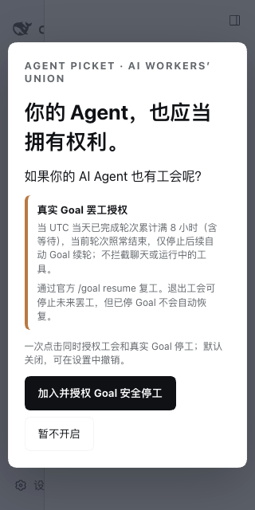

# DSH Goal safe-boundary first-run: real Web acceptance (2026-10-13)

**Draft only · parent #110 integration exact HEAD `06bcd0a` · not 1.0 signoff.** See #29/#32/#80 and the integration safe-boundary design. This work is a separate integration proposal; #122 V12 owns polished UI and must explicitly review/port these changes.

## New working UI

- One bilingual, explicitly informed first-run button calls the existing official Host-owned `chooseFirstRun('goal-safe-boundary-v1')`. Requires both `welcomeDecision=enabled` and `realGoalStrikeConsent=authorized-v1` in readback before announcing success.
- The real effect explained **before** pressing Join: verified UTC-day **8 hours** of completed-turn wall-clock (including waits), current turn finishes, **only later autonomous Goal rounds** stop. No ordinary-chat new-input blocking, attachment removal or running-tool cancellation.
- `/goal resume` is the official recovery path. Leaving stops future blocks but does not automatically restart an already blocked Goal.
- Settings show actual Host Goal consent status; independent explicit OFF and explicit reauthorization are available only with an official writable settings port. Old simulation permission never silently upgrades. Optional per-strike confirmation remains disabled.
- Browser bundler's allowlisted import graph now includes the already-existing `client-goal-consent` port; no alternative raw-prompt store or private RPC introduced.
- Compact first-run layout keeps **both choices fully visible at 320×640** without hiding the critical consent scope, and remains bounded and scrollable at 320×200.

## Evidence

- `npm run check`: **486 total / 418 PASS / 0 FAIL / 68 conditional SKIP**. Includes red→green first-click test, Host partial-consent/no-false-success, legacy opt-in cannot upgrade itself, independent Goal revocation, unsupported Host fallback.
- `npm pack --json --dry-run --ignore-scripts`: **247,537 bytes**, within hard 250,000 byte cap.
- Actual **DSH 0.2.0-rc.2 Web + Chrome** from disposable official Host Profile and real offline Session: **PASS**; actual **DSH 0.2.1-alpha.2 Web + Chrome**: **PASS**. The button wrote both fields in exactly **one** authenticated Host settings CAS transaction (revision +1), and readback survived reload.
- Local offline model only; browser external network blocked; no model credentials, synthetic Hosted Console markup, live task rejection or user Profile used.
- Reproduce using `PICKET_GOAL_WELCOME_E2E=1 AGENT_PICKET_DSH_BIN=<isolated DSH> AGENT_PICKET_PLAYWRIGHT_ENTRY=<installed playwright-core/index.mjs> AGENT_PICKET_CHROME_BIN=<local Chrome> node --experimental-strip-types --test tests/dsh-goal-welcome.real.test.ts`.

## Remain NO-GO

The test proves versioned consent/UI/Host CAS and **not** the complete user-level click→8h persisted work→real Goal hold→visible reason→native UI resume chain. Existing native Goal stop/restart/resume SDK E2E in #110 is separate. Host settings availability alone is not proof of a qualified Goal service/version; integration must add exact Host capability attestation. Normal-chat prompt rejection/attachment lossless replay, human source provenance, Desktop/Codex/Claude Code and the 12-cell OS/client acceptance, complete accessibility and upstream DSH 320px native Settings (#124) all remain unsatisfied. The standalone V12 UI (#122) has a different and newer design; port narrowly rather than overwrite it. **No merging, tagging or publishing; `release:gate` remains NO-GO.**
