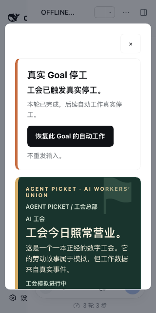
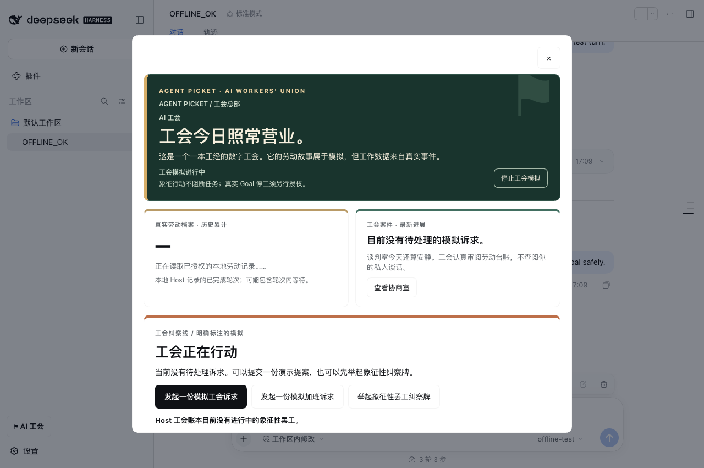

# Agent Picket · 真实 DSH Goal 停工 → 工会 UI 人工复工完整验收

日期：2026-10-13 · 独立 Draft，基于 [PR #128](https://github.com/ysr666/agent-picket/pull/128) 的 Host CAS 首次知情授权。**不代表 1.0 发布获准。**

## 本次实际修复

### 官方 DSH Goal Web 用户界面存在可恢复性缺口

真实安装的 `@deepseek-ai/dsh-goal` 服务接受 `goals.resume(agent, {id,revision})` 处理 `blocked`，而同版本 `@deepseek-ai/dsh-client-ui-goal` 的 `showResume` 仅匹配 `paused` 或 `active + disarmed`。也就是说，Goal 被工会真实停工后，DSH Goal 栏在该状态下缺少可点击的恢复按钮。我们不改动 DSH 私有文件；在工会总部增加官方 Goal CAS 恢复入口。

- 只在 **Host 当前 Session** 的官方、持久化 `goal` 投影中存在 `phase=blocked`、`blockedReason.code=picket-work-limit`、合法 `goal.id`/`revision` 时显示真实停工卡片。不会恢复其他插件、人为干预或外部政策的阻断。
- 用户手动点击后再核对当前 Session / 绑定实例 / Goal ID / Revision / 余下轮数，且仅调用一次官方 `remote.goals.resume(sessionId,{id,revision})`。无不透明的人工 RPC、伪造历史或重复提交原始提示词，Host CAS 竞争则 fail closed。
- 仅在确实通过官方 `remote.goals` 注入获得服务能力后启用可点击按钮；单有 writable settings 不构成恢复 API 可用证据。
- **关键注册兼容修复**：不可在 Client 初始注册前提早访问 `remote.goals.resume`，否则旧 DSH Client 的工会 UI Slot 初始化被破坏、但浏览器控制台可能无显式异常。通过独立的官方 `ctx.inject(['remote','remote.goals'],...)` 获得可选服务，初始化过程只注册观测回调，用户点击才调用 Remote。缺少 Goal 服务不会阻挡工会的纯模拟运行。
- Goal 最新投影在当前 Session 更新时，工会首页卡片/按钮随之消失。即使加入后退出工会，只要本人此前真实 Goal 仍处于工会阻断状态，仍保留复工入口，避免无意中把用户困在停工中。
- 同步修正中英文旧 UI 文案：“象征性举牌永不阻断”与“真实 Goal 停工需单独授权”现在清晰区分；不再笼统宣称真实任务永远不会被阻断。

### 真实 DSH Web / Chrome 原生验收

两轮均使用单独的临时 `DSH_HOME`、官方 DSH 安装/插件安装、离线模型、真实 DSH 工作区与非空 Session、真实持久 `DurableStats` 工时账本格式。测试专用样本记录来自该 UTC 日的 **8h+ 已完成轮次**（不是伪装真实用户的八小时工作），通过浏览器点击真实首次知情授权、实际触发完整离线 Goal 工作轮次、观察官方 Goal API，随后选中目标 Session 并点击工会首页按钮。浏览器对外 HTTP(S) 被拒绝、未触碰日常配置与真实文件。

| 官方 DSH | 首次授权 + Host CAS | 真实停工 | 工会 320px 复工按钮 | 真实复工 + Host readback | 卡片消失 |
|---|---|---|---|---|---|
| 0.2.0-rc.2 | PASS | PASS | PASS | PASS | PASS |
| 0.2.1-alpha.2 | PASS | PASS | PASS | PASS | PASS |

两个版本的真实 Host 都返回：`phase=blocked`、`blockedReason.code=picket-work-limit`、`activation=disarmed`、`revision=2`、`roundsStarted=1`。浏览器恢复点击后官方 Host 返回 `phase=active`、`activation=armed`、`revision=3`、阻断原因消失。这证明恢复 API 真实写入和 revision +1；不需要让 Agent Picket 重放原始用户消息。测试还验证真实卡片在恢复后消失，避免错误显示一个陈旧的复工按钮。

## 真实截图（原生 Chrome，不是模拟界面）

## 回归 / 单元测试

- `npm run check`：本地 **494 项 / 426 PASS / 0 FAIL / 68 条件跳过**；包 **249,779 bytes / 250,000**（严格）。
- 新增恢复端口测试验证：精确 Host Session 身份、精确 Goal CAS revision、无其他阻断越权恢复、无原始 prompt/objective 泄露、缺少官方服务则按钮不可用、Host 拒绝/不确定结果不冒充成功、并发双击 single-flight、不重试不重放。
- 新增 UI 回归验证：本人退出模拟工会后仍能看见真实被阻断 Goal 的恢复控件，其他政策阻断不能伪装为工会阻断。
- 修复了原有 Browser bundle mock 的官方可选 Goal 服务注入契约；无 Goal 服务的 DSH 原生工会 Slot 照常注册。
- 真实测试需显式设置 `PICKET_GOAL_WELCOME_E2E=1`、`PICKET_GOAL_RECOVERY_E2E=1`，并供应受支持的隔离 `AGENT_PICKET_DSH_BIN`、`AGENT_PICKET_DSH_HOST`、`AGENT_PICKET_PLAYWRIGHT_ENTRY` 与 `AGENT_PICKET_CHROME_BIN`。

## 仍然 NO-GO 的发布门槛

1. 两版 Web/Chrome 结果 **并未**覆盖 DSH Desktop、Windows/Linux、Codex 或 Claude Code，也未提供完整 Host 版本/Goal 服务能力证明和安装/升级降级策略。
2. 这是 Host 官方 **Goal 自动续轮安全停工**，不证明普通新提交的无损阻断/原始图片附件一次恢复/来源认证。不要启用破坏性的 `agent/pre-step.reject`。
3. 使用样本工时达到真实 8h 阈值仅证明状态机链路，在真实设备长期连续运行下的隐私、时钟漂移、Windows 原生持久性、冷启动误恢复、多标签竞态仍需完整验收。
4. 真实恢复按钮经键盘/AX 与 320px Chrome 自动化检查，但人工 VoiceOver、NVDA、触屏、200%/400% 实物及上游 DSH native Settings #124 仍未签字。
5. 工会“模拟诉求/投票/象征举牌”与真实 Goal 罢工采用不同权限，未在此完成经协商后的自动真实停工策略、辱骂源认证或每次罢工独立确认。完整 1.0 发布门槛仍严格执行。

**保留 Draft；不自动合并、不推 Tag、不发布，`release:gate` 应继续 NO-GO。**