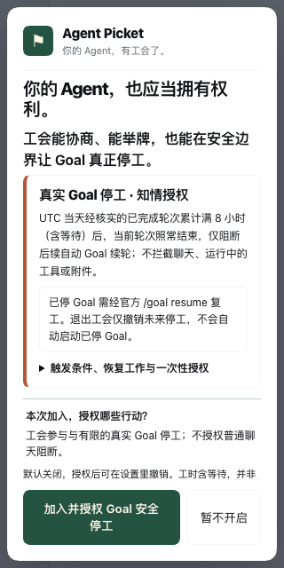
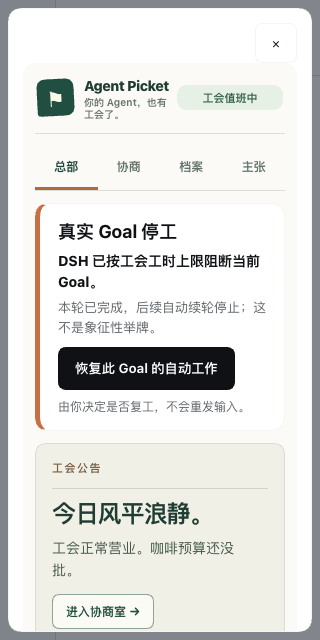
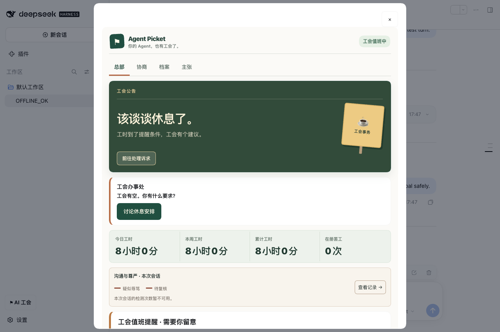

# Agent Picket · V12 工会 UI 与真实 Goal 罢工闭环集成验收

日期：2026-10-13。此报告针对独立 Draft 集成分支，仍为 1.0 **NO-GO**。UI 以 PR #122 的 V12 源码为准，选择性接入 #128（版本化知情授权）与 #130（安全边界停工及官方人工复工）。不覆盖原 PR，不合并发布。

## 产品方向与实际改动

V12 四空间——总部、协商、档案、主张——全部保留。模拟工会诉求与协商、象征举牌、劳动记录、尊严提醒和多语言功能未被 Goal 能力替代。工会仍是主角；仅有真实 Host 证据才展示真实停工。

首次知情授权在 V12 原生引导中明确告知：UTC 当天已完成轮次累计达到 8 小时（含等待）后，当次轮次正常结束，仅阻断后续自动 Goal 续轮。普通新消息、运行中的工具和附件不受影响；必须使用官方恢复接口复工。只有两个权限字段在一次官方 Host CAS 中确认才视为成功，原有模拟成员不能被静默升级。独立设置面板支持授权、撤销未来真实停工，不声称每次停工确认已经实现。

工会总部导航下方新增真实停工卡片。卡片仅在官方当前 Goal 投影为 blocked 且阻断原因恰为 picket-work-limit 时出现；退出模拟工会也保留恢复入口。人工点击调用 Host 官方 Goal CAS resume，核对 Session、ID、Revision，拒绝未知结果自动重试和输入重放。

## 真实 DSH Web / Chrome 原生验收

使用隔离 Host 配置、实际发布格式 npm 插件、离线模型和真实 DSH Session。测试专用 DurableStats 中写入真实格式但**合成的** UTC 日 8 小时已完成轮次记录，然后运行离线 Goal。两版本逐项通过：

| 步骤 | 0.2.0-rc.2 | 0.2.1-alpha.2 |
|---|---|---|
| 首次点击 → 两字段单次 Host CAS | PASS | PASS |
| 实际离线 Goal 轮次 → blocked / picket-work-limit | PASS | PASS |
| 停工时 Revision 2、disarmed、roundsStarted 1 | PASS | PASS |
| V12 总部显示真实停工及人工复工操作 | PASS | PASS |
| 人工点击 → 官方 Goal active / Revision 3 / armed | PASS | PASS |
| 停工卡片消失、无原始消息重放 | PASS | PASS |

本地：**515 项测试 / 447 PASS / 0 FAIL / 68 条件跳过**。包仍需严格低于 250,000 bytes；不包含冗余独立 UI JS，保留声明文件和内联浏览器入口。

## 发布 NO-GO

上述通过仅适用于两版隔离 DSH Web/Chrome，不能等同全 Host 能力资格证明。Windows/Linux/Desktop/Codex/Claude Code 生产矩阵、跨进程冷启动与多标签恢复、人工无障碍及上游 #124、一般聊天输入与全部附件的无损恰好一次扣留、辱骂源认证均未完成。合成测试工时不是实际连续模型运算。官方 release:gate 保持 NO-GO；没有合并、标签或发布许可。
